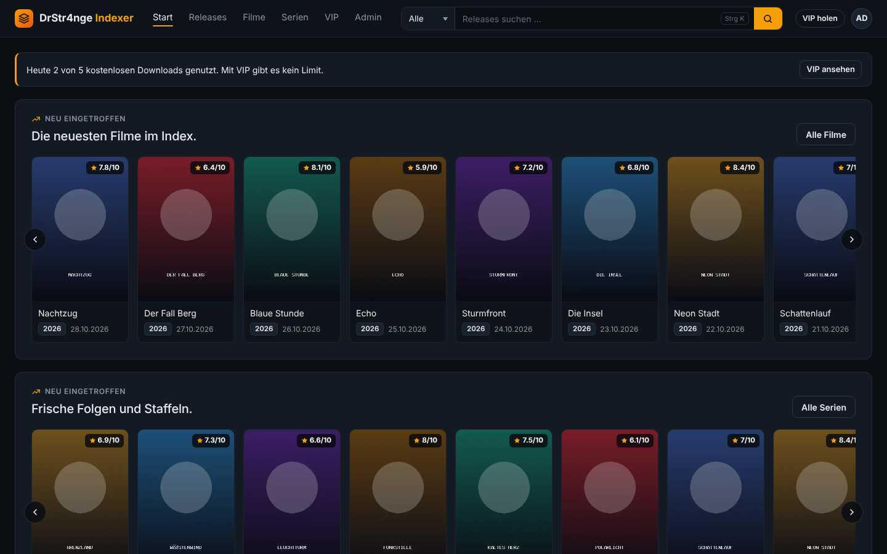
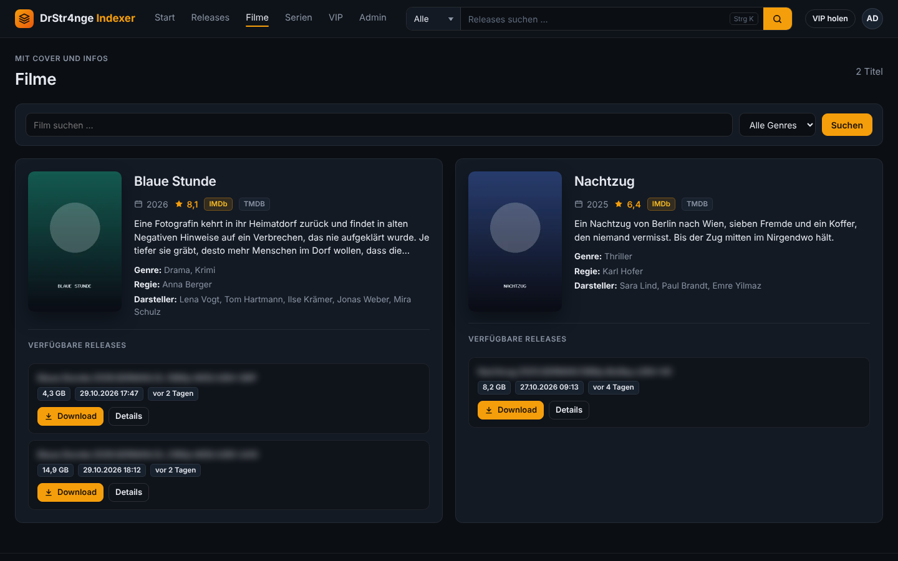
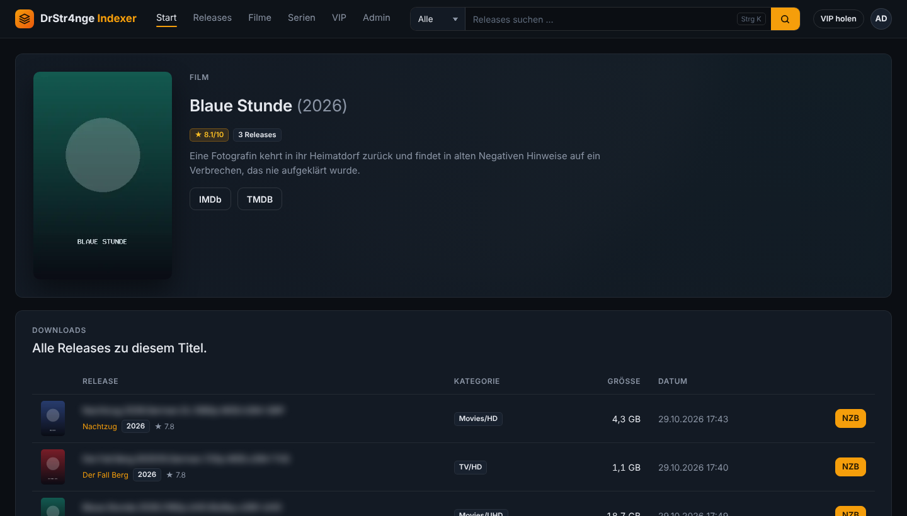
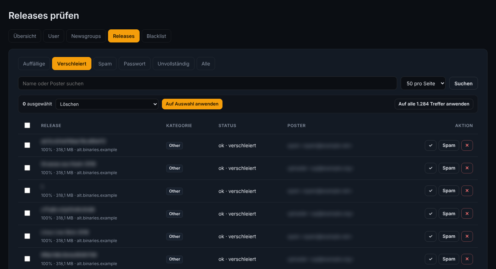
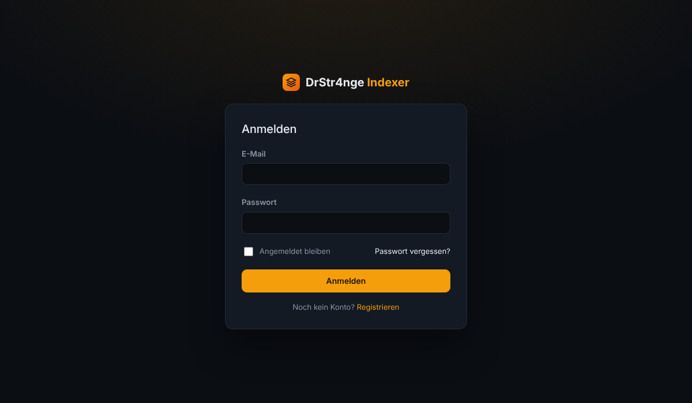

<h1 align="center">DrStr4nge Indexer</h1>

<p align="center">
  Selbst gehosteter Usenet-Indexer mit Newznab-API, Cover und Filminfos, User- und Admin-Bereich und VIP-Zugang per Krypto-Zahlung.
</p>

<p align="center">
  
  
  
  
  
</p>

<p align="center">
  
</p>

DrStr4nge Indexer liest die Header deiner Newsgroups, baut daraus Releases und stellt sie über eine Weboberfläche und eine
Newznab-kompatible API bereit, zum Beispiel für Sonarr und Radarr. Filme und Serien bekommen automatisch Cover, Inhalt,
Genre, Regie und Darsteller. Gebaut mit Laravel, gedacht für einen eigenen Server mit Ubuntu 24.04 und PHP 8.5.
Die Oberfläche ist auf Deutsch.

## Funktionen

**Indexing**
- Crawler für beliebig viele Newsgroups, mehrere Verbindungen gleichzeitig (`NNTP_CONNECTIONS`)
- Versteht klassische und abweichende Betreffzeilen (inkl. Platzhalter wie "Description" und Latin-1-Umlauten)
- Kategorien nach Newznab: Filme (SD/HD/UHD/BluRay), TV (SD/HD/UHD/Sport/Anime), Audio, Bücher, Comics, PC, Spiele, Konsolen, XXX
- Verschleierte Namen werden erkannt und über die PAR2-Datei aufgelöst
- Erkennung passwortgeschützter RAR-Archive (RAR4 und RAR5)
- Spam-Schutz: Blacklist für Poster und Namen (Regex), Spam-Wörter, nur ausführbare Dateien, zu kleine Releases
- Automatisches Aufräumen: alte, unvollständige, verschleierte, passwortgeschützte und Spam-Releases
- Verschleierte Releases werden über PAR2 und zusätzlich über die PreDB (Größe, Dateianzahl, Zeit) benannt
- Serien-IDs (TVDB, TVmaze) über TVmaze für zuverlässigere Treffer in Sonarr
- Pre-Daten aus IRC (#PreNNTmux, #nZEDbPRE), von predb.net, per RSS (predb.me) und aus alten nZEDb-Dumps: Pre-Zeit und Nukes direkt an den Releases
- NZB-Export, optional Volltextsuche mit Manticore Search (sonst MySQL)

**Für User**
- Startseite mit Cover-Reihen, Seiten für Filme und Serien mit Infos und Releases, Detailseite pro Titel
- Suche mit Kategorien (Strg+K), läuft auch auf dem Handy
- Newznab-API mit `search`, `tvsearch`, `movie`, `get` sowie Suche über IMDb-, TMDB- und TVDB-ID
- Konto-Seite mit API-Key und Download-Verlauf, Tageslimit für kostenlose Konten
- Registrierung: offen, nur mit Einladungscode oder geschlossen
- Merkliste für Filme und Serien, RSS-Feeds (neu, Merkliste, Kategorien) für NZBGet/SABnzbd
- Releases melden (defekt, Passwort, falscher Name, Spam)

**VIP und Zahlung**
- VIP ohne Download-Limit und mit höherem API-Limit
- Bezahlung per Krypto über **NOWPayments** (z.B. Monero, ohne eigenen Node) oder **BTCPay Server** (selbst gehostet)
- Freischaltung automatisch nach bestätigter Zahlung, Rückmeldungen werden per Signatur geprüft

**Für Admins**
- Übersicht mit Betrieb (Crawler, Sicherung, Pre-Daten) und Server-Auslastung (CPU, RAM, Speicherplatz), User-Verwaltung (VIP, Sperren, Admin), Newsgroups (inkl. "Neu einlesen")
- Releases prüfen mit Filtern, Suche und Mehrfachauswahl (freigeben, Spam, löschen, Poster sperren)
- PreDB mit Status und Einstellungen des IRC-Scrapers (Kanäle direkt im Admin änderbar), Blacklist, Zahlungen, Einladungscodes
- Zugangsdaten im Admin: Usenet, TMDB, Mail, Zahlung, Sicherung, ohne `.env`
- Einstellungen: Name der Seite, eigenes Logo, Registrierungs-Modus
- Zwei-Faktor-Anmeldung (Code-App), auf Wunsch Pflicht für alle Admins
- Tägliche Sicherung, auf Wunsch zusätzlich nach Google Drive
- Überwachung mit Warn-Mails (Crawler steht, IRC getrennt, Platte voll, Sicherung fehlt) und Log-Ansicht
- Meldungen der User bearbeiten, `indexer:status` zeigt alles auf einen Blick
- Verbindungstest zum Usenet-Provider mit verständlichen Fehlermeldungen

## Screenshots

| Filme mit Infos | Detailseite |
|---|---|
|  |  |
| **Admin: Releases prüfen** | **Login** |
|  |  |

Die Cover in den Screenshots sind Platzhalter.

## Voraussetzungen

- Server mit **Ubuntu 24.04 LTS** (empfohlen: 2 Kerne, 4 GB RAM, je nach Anzahl der Releases 20 GB+ Speicher)
- Zugang bei einem Usenet-Provider (Server, Benutzer, Passwort)
- Optional: kostenloser API-Key von [TMDB](https://www.themoviedb.org) für Cover und Filminfos
- Optional: Konto bei NOWPayments oder ein eigener BTCPay Server für VIP-Zahlungen

Alles andere (PHP 8.5, Composer, Node.js, MariaDB, Nginx, optional Manticore und SSL) installiert das Skript.

## Schnellstart

```bash
git clone https://github.com/DrStr4nge-source/drstr4nge-indexer.git
cd drstr4nge-indexer
sudo bash install.sh
```

Das Skript fragt nach Domain oder IP, Admin-E-Mail, Manticore und SSL und richtet dann alles ein. Am Ende steht das
Passwort des ersten Admins auf dem Bildschirm.

Danach:

1. Falls bei der Installation nicht angegeben: im Admin unter **Zugangsdaten** den Usenet-Zugang eintragen, optional TMDB-Key,
   Mail und Zahlung.
2. Verbindung prüfen: `cd /var/www/indexer && php artisan indexer:test-nntp`
3. Einloggen, im Admin unter "Newsgroups" Gruppen eintragen, unter "Einstellungen" Name, Logo und Registrierung festlegen.
4. Ersten Crawl starten: `sudo -u www-data php artisan indexer:crawl`. Danach läuft alles automatisch per Cronjob.

Das Skript fragt auch nach Usenet-Zugang, TMDB-Key, IRC-Nick, Mail-Versand und Google-Drive-Sicherung. Alles davon lässt sich
auch später im Admin unter **Zugangsdaten** eintragen.

## Update

```bash
cd /tmp && rm -rf dsi && git clone -q https://github.com/DrStr4nge-source/drstr4nge-indexer.git dsi && sudo bash dsi/update.sh
```

Daten, `.env`, Logo, Cover und Einstellungen bleiben erhalten. Das Skript ergänzt neue `.env`-Einträge, aktualisiert Datenbank und
Zeitplan und startet die Dienste neu.

Die ausführliche Anleitung mit manueller Installation, allen Einstellungen und Fehlersuche steht in
**[docs/ANLEITUNG.md](docs/ANLEITUNG.md)**.

## Wichtige Einstellungen (.env)

| Eintrag | Bedeutung | Standard |
|---|---|---|
| `NNTP_HOST`, `NNTP_PORT`, `NNTP_SSL`, `NNTP_USER`, `NNTP_PASS` | Zugang zum Usenet-Provider | Port 563, SSL an |
| `NNTP_CONNECTIONS` | gleichzeitige Verbindungen des Crawlers | 4 |
| `INDEXER_BACKFILL_DAYS` | erster Crawl einer Gruppe: so viele Tage zurück (0 = nach Anzahl) | 0 |
| `INDEXER_BACKFILL` | sonst: neueste Artikel beim ersten Crawl einer Gruppe | 100000 |
| `INDEXER_FREE_GRABS` | Downloads pro Tag ohne VIP | 5 |
| `INDEXER_RETENTION_DAYS` | Releases danach löschen | 1000 |
| `INDEXER_DELETE_OBFUSCATED_DAYS` / `..._PASSWORDED_DAYS` | verschleierte bzw. passwortgeschützte löschen nach X Tagen (0 = nie) | 3 / 1 |
| `TMDB_API_KEY`, `TMDB_LANGUAGE` | Cover und Filminfos | –, de-DE |
| `PAYMENT_PROVIDER` | `nowpayments` oder `btcpay` | btcpay |
| `NOWPAYMENTS_API_KEY`, `NOWPAYMENTS_IPN_SECRET`, `NOWPAYMENTS_PAY_CURRENCY` | NOWPayments, z.B. `xmr` für nur Monero | – |
| `SCRAPE_IRC_USERNAME`, `SCRAPE_IRC_CHANNELS` | Pre-Daten aus IRC (Nick leer = aus) | – |
| `PREDB_API_ENABLED` | Pre-Daten von predb.net | true |
| `BACKUP_KEEP_DAYS`, `BACKUP_RCLONE_REMOTE` | Sicherung: Tage, Cloud-Ziel (z.B. `gdrive:drstr4nge-backups`) | 7, – |
| `ALERT_EMAIL` | Warn-Mails an (leer = alle Admins) | – |
| `INDEXER_TIMEZONE` | Zeitzone für Anzeige und Zeitplan | Europe/Berlin |
| `MANTICORE_ENABLED` | Volltextsuche mit Manticore | false |

Alle Einträge mit Erklärung stehen in [`env.additions.txt`](env.additions.txt), VIP-Preise und Kategorien in
[`config/indexer.php`](config/indexer.php).

## Aufbau

Das Repository enthält nur die Indexer-Dateien. `install.sh` legt ein frisches Laravel mit Breeze (Login) an und kopiert
diese Ordner darüber:

```
app/          Crawler, Erkennung, Metadaten, Suche, Zahlungen, Controller, Befehle (indexer:*)
config/       indexer.php mit allen Einstellungen
database/     Migrationen
resources/    Oberfläche (Blade-Vorlagen, dunkles Theme)
routes/       Seiten, Newznab-API, Admin, Webhooks
tests/        Unit- und Feature-Tests (php artisan test)
docs/         Anleitung und Screenshots
install.sh    Installer für Ubuntu 24.04
update.sh     Update einer bestehenden Installation
setup-gdrive.sh  Google-Drive-Sicherung auf dem Server einrichten (geht auch im Admin)
```

## Rechtlicher Hinweis

DrStr4nge Indexer speichert keine Inhalte, sondern nur Header-Informationen aus dem Usenet und erzeugt daraus NZB-Dateien.
Du bist selbst dafür verantwortlich, dass der Betrieb und die Nutzung den Gesetzen deines Landes und den Bedingungen deines
Usenet-Providers entsprechen. Das Projekt ist nicht für die Verbreitung urheberrechtlich geschützter Inhalte gedacht.

**TMDB:** Dieses Produkt nutzt die TMDB-API, wird aber von TMDB weder unterstützt noch zertifiziert. Die TMDB-API ist nur für
nicht-kommerzielle Nutzung kostenlos. Wer VIP-Zugang verkauft, braucht in der Regel eine kommerzielle Vereinbarung mit TMDB.

## Danke an

[Laravel](https://laravel.com) · [Laravel Breeze](https://github.com/laravel/breeze) · [Manticore Search](https://manticoresearch.com) ·
[TMDB](https://www.themoviedb.org) · [NOWPayments](https://nowpayments.io) · [BTCPay Server](https://btcpayserver.org)

## Lizenz

Copyright (C) 2026 DrStr4nge-source

Dieses Programm ist freie Software: Du kannst es unter den Bedingungen der **GNU General Public License Version 3**
(GPL-3.0) weitergeben und verändern. Wer eine veränderte Version weitergibt, muss den Quellcode ebenfalls unter der GPL-3.0
veröffentlichen. Das Programm wird ohne jede Gewährleistung bereitgestellt. Den vollständigen Text findest du in der Datei
[LICENSE](LICENSE).
